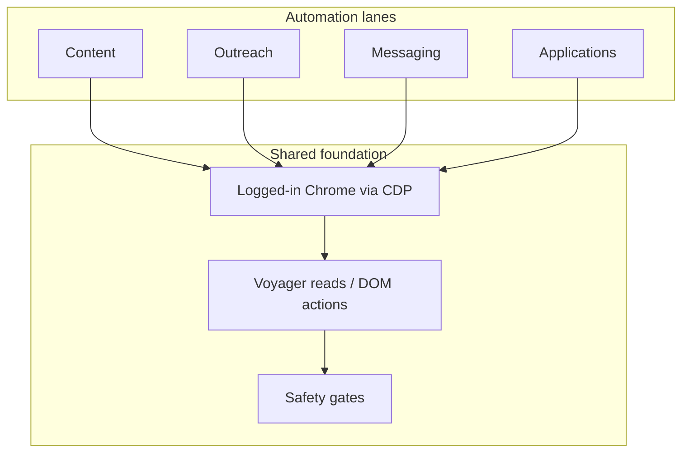

# linkedin-cdp-kit

TypeScript library for reading and interacting with LinkedIn through **your own** logged-in Chrome session via CDP and Voyager APIs.

This is **unofficial**. LinkedIn's web UI and internal APIs change without notice. Automated use may violate LinkedIn's Terms of Service and can trigger rate limits or account restrictions. **You are responsible for compliance and pacing.**

## Capability map

Four automation lanes sit on shared session infrastructure: logged-in Chrome via CDP, Voyager-backed reads, and safety gates (dry-run unless `--live`, account guard, pacing, no auto-retry after uncertain outcomes).



Import lane namespaces from the package entry:

```ts
import { content, outreach, messaging, applications } from 'linkedin-cdp-kit';
```

## Content automation

Feed reads, reactions, shares, comment actions, and the comment capture → draft → approve → execute pipeline. Plugins cover reference bundles, style linting, target rotation, and outbound content filtering.

| What you can do | API (`content.*`) | CLI |
|-----------------|-------------------|-----|
| Read the home feed | `readFeed` | — |
| React to a post | `reactToPost` | — |
| Share a post | `sharePost` | — |
| List comments on a post | `listComments` | — |
| Post a comment (live) | `commentOnPostLive` | `comments run --live` |
| Reply to a comment | `replyToComment` | — |
| Capture posts and draft comments | `captureAndDraft` | `comments capture <slug>` |
| Approve a pending comment | `approveProposal` | `comments approve <id> --text` |
| Execute approved comments | `runCommentExecutor` | `comments run --live` |
| Load reference bundle files | `loadReferenceBundle` | — |
| Style linter (max length, etc.) | `builtinMaxLengthLinter`, `draftWithReviseOnce` | — |
| Target rotation selector | `TargetRotationSelector` | — |
| Content filter / refusal rules | `filterCommentContent`, `contentRefusal` | — |

List pending proposals: `comments list`.

## Outreach automation

People search, connectability probes, connection invites, discovery refill, grading, profile verify, the contact ledger, connection scraping, cooldown policies, and unavailable-profile audit.

| What you can do | API (`outreach.*`) | CLI |
|-----------------|-------------------|-----|
| Search people (Voyager + DOM) | `searchPeople` | — |
| Probe connect / follow / pending | `probeConnectability` | — |
| Send connection invite (live) | `sendConnectionInviteLive` | `invites run --live` |
| Invite runner status / resume | `runInvites`, `inviteStatus`, `resumeInvites` | `invites status`, `invites run --live`, `invites resume --reason` |
| Discovery refill into queue | `runRefill` | `refill --json` / `--csv` |
| Grade / qualify candidates | `defaultScoreGrader`, `applyGradeToQueue`, `orderQualifiedQueue` | — |
| Profile verify for research queue | `runVerify` | `verify [--live]` |
| Contact ledger read / import | `readContactLedger`, `listContacts`, `importConnectionsCsv` | `contacts list`, `contacts import-csv <file>` |
| Scrape connections page | `scrapeConnections` | `connections --cdp-url` |
| Cooldown policies | `FixedCooldownPolicy`, `BayesianCooldownPolicy`, … | — |
| Unavailable slug audit | `auditUnavailable`, `applyUnavailableAudit` | `audit-unavailable --probes <json> [--apply]` |

## Messaging automation

Inbox listing, thread history, send and send-by-name resolution, realtime listen, ingest → drafts, follow-up nudges, and intent routing.

| What you can do | API (`messaging.*`) | CLI |
|-----------------|---------------------|-----|
| List inbox conversations | `listConversations` | `inbox --cdp-url` |
| Pull full thread history | `pullThread` | `inbox --history --thread <urn>` |
| Send a message (live) | `sendMessageLive` | `messaging send --live` |
| Match thread by participant name | `matchConversationsByName` | — |
| Listen for inbound messages | `LinkedInMessageListener` | — |
| Ingest threads and queue drafts | `ingestAndQueueDrafts`, `ingestConversation` | `messaging ingest` |
| Read / write draft files | `readDrafts`, `writeDrafts` | `messaging list`, `messaging approve`, `messaging edit`, `messaging reject` |
| Follow-up nudge drafts | `createNudgeDrafts`, `shouldCreateNudge` | `messaging followups` |
| Intent router / routed drafts | `KeywordIntentRouter`, `routeAndDraft` | hooks via `messaging ingest --hooks` |

Local review UI: `review --port` (default **5290**).

## Application automation

Attended Easy Apply: one job URL, modal-scoped steps, resume upload, and explicit gates for 2FA, captcha, or external apply.

| What you can do | API (`applications.*`) | CLI |
|-----------------|------------------------|-----|
| Run Easy Apply on a job URL | `easyApplyToJob` | — |

Call `easyApplyToJob` from TypeScript with `live: true` after you connect a session. There is no CLI subcommand yet.

## How the pipeline fits

Outreach, comments, and messaging share the same **discover → grade → queue → approve → execute** rhythm. Discovery (`runRefill`) fills the invite queue. Grading and verify enrich or reject candidates. Operators approve proposals or drafts (CLI or `review` UI). Runners (`runInvites`, `runCommentExecutor`, `messaging send`) execute only after approval and respect dry-run, pacing, and cooldown state in `--state-dir`.

Easy Apply is separate: a single attended flow per job with its own modal gates and no shared approval queue.

## Quick start

1. Launch Chrome with a dedicated profile and remote debugging:

```bash
google-chrome \
  --user-data-dir=/tmp/linkedin-cdp-profile \
  --remote-debugging-port=9222 \
  https://www.linkedin.com/feed/
```

2. Log in manually in that window.

3. Use the library (after `npm run build`):

```ts
import { LinkedInSession, SessionLinkedInActions } from 'linkedin-cdp-kit';

const session = new LinkedInSession();
await session.connect({
  cdpUrl: 'http://127.0.0.1:9222',
  expectedAccount: { publicIdentifier: 'example-user' },
});
const actions = new SessionLinkedInActions(session);
const profile = await actions.fetchProfile('example-user');
await session.close();
```

## CLI

All **write** paths default to dry-run unless you pass `--live`. Live reads and writes require `--cdp-url` and persistent state uses `--state-dir`.

```bash
node --import tsx bin/linkedin-cdp.ts --state-dir ./state invites status
node --import tsx bin/linkedin-cdp.ts --state-dir ./state refill --json ./candidates.json
node --import tsx bin/linkedin-cdp.ts --state-dir ./state doctor
node --import tsx bin/linkedin-cdp.ts --cdp-url http://127.0.0.1:9222 profile example-user --posts
node --import tsx bin/linkedin-cdp.ts --state-dir ./state --cdp-url http://127.0.0.1:9222 invites run --live
```

### Commands

| Domain | Subcommands |
|--------|-------------|
| `invites` | `status`, `run [--live]`, `resume --reason` |
| `comments` | `capture`, `list`, `approve <id> --text`, `reject <id>`, `run [--live]` |
| `messaging` | `ingest`, `list`, `approve`, `edit`, `reject`, `send`, `followups` (dry-run drafts only) |
| `review` | local UI on `127.0.0.1` — `--port` (example default **5290**) |
| `refill` | `--json` and/or `--csv`, optional `--strategy` |
| `verify` | `[--live]` profile enrichment for research queue |
| `contacts` | `import-csv <file>`, `list [--state]` |
| `audit-unavailable` | `--probes <json>` [`--apply`] |
| `doctor` | health checks for all lanes |
| `profile`, `inbox`, `connections`, `capture-query-ids` | read tooling (`--cdp-url`) |

## Browser launcher (`src/browser/`)

`waitForNetwork` probes TCP port **443** (configurable hosts). `checkCaptivePortal` hits Google’s `generate_204` with `redirect: manual`. `launchChrome` spawns a **headed** Chrome with an explicit `--user-data-dir` (refuses the default profile). `launchIsolatedChrome` is a `BrowserProvider` that optionally runs `waitForNetwork` before spawn.

## People search & connectability

`searchPeople` builds the Voyager people-search request and parses results, with DOM harvest fallback (`PEOPLE_SEARCH_HARVEST_EXPR`). `pickBestPeopleMatch` applies hint and **name-token** verification so sidebar cards cannot win. `probeConnectability` reports `connect | follow | pending | message | email_required | unavailable` without sending invites.

## Content filter

`contentRefusal` / `filterCommentContent` implement the full lookalike rules (NFC/NFKC, Latin folds, TLD tricks, IPv4, phones, hashtags, copy-span). Regression cases live in `fixtures/content-filter-cases.json`.

## Adaptive cooldown

`BayesianCooldownPolicy` ports episode-grid estimation from receipt-led limit observations. `FixedCooldownPolicy` stays the simple default; one verified success does **not** claim a full quota reset.

## Feed & Easy Apply

`readFeed`, `reactToPost`, `sharePost`, `listComments`, and `replyToComment` are DOM-first (`--live` for real clicks). `easyApplyToJob` scopes to the Easy Apply modal, advances only via stable aria-labels, uploads a fresh resume PDF, never clicks Save and exit / Dismiss, and surfaces 2FA/captcha/external apply as gates. Both default to dry-run unless `--live`.

## API overview

| Area | Entry points |
|------|----------------|
| Lanes | `content`, `outreach`, `messaging`, `applications` |
| Session | `LinkedInSession`, `checkAccountGuard`, `SessionLinkedInActions` |
| Browser | `launchChrome`, `launchIsolatedChrome`, `waitForNetwork`, `checkCaptivePortal` |
| Actions | `sendMessageLive`, `commentOnPostLive`, `sendConnectionInviteLive`, `verifySentInvites`, `searchPeople`, `probeConnectability`, `readFeed`, `easyApplyToJob` |
| Review UI | `startReviewServer`, `createNudgeDrafts` |
| Pipeline | `runRefill`, `runVerify`, `ContactLedger`, `evaluateHealth`, `AlertDispatcher` |
| Automation | `runInvites`, `captureAndDraft`, `dispatchOne`, `FileStore` |

## Hooks module (`--hooks <file>`)

Load a user ESM module for product-specific logic. Export any of:

```ts
export function qualify(candidate: { slug: string; name: string }): {
  decision: 'qualify' | 'reject' | 'needs_research';
  reason?: string;
};

export function draft(
  post: { text: string; activityId?: string | null },
  ctx: { slug: string; reference?: unknown },
): { text: string } | { skip: true; reason: string };

export function classify(thread: Record<string, unknown>):
  | { label: string }
  | { skip: true; reason: string };
```

Pipeline plugins (`DiscoverySource`, `Grader`, `StyleLinter`, `ApprovalChannel`, `IntentRouter`, `CooldownPolicy`, `AlertChannel`) are composed in code or via `examples/discovery-source-plugin.ts`.

## Pipeline architecture (`src/pipeline/`)

1. **Strategy** — `AudienceProfile` from JSON or Markdown directory; threaded into grading and drafting context.
2. **Discovery** — `DiscoverySource` plugins, `runRefill()` with cursor persistence and dedup (no Chrome).
3. **Grading / verify** — `Grader` decisions, ordered `invite-qualified.json`, research queue with verify backoff (`1d → 3d → 7d → 30d`) and stale capture flags.
4. **Contacts** — lifecycle ledger, `Connections.csv` import, scrape sync, unavailable audit prune/repair.
5. **Comments plugins** — `ReferenceBundle`, `StyleLinter` revise-once loop, `TargetRotationSelector`, `ApprovalChannel`.
6. **Messaging plugins** — `IntentRouter`, `ReplyStrategy`, optional `HandoffAction`.
7. **Health / alerts** — `evaluateHealth()`, rate-limited `AlertDispatcher` with console and webhook channels.

## Gotchas

- **Viewer gate:** blurred DOM on profile pages does not block the identity API — prefer `fetchProfile` over DOM scraping for About/Experience.
- **Shadow DOM invites:** connection modal controls require shadow-root traversal; use `.click()` on elements, not raw coordinate clicks.
- **Sidebar contamination:** verify invite dialog text and profile title against the intended recipient; optional `--profile` fallback navigates `/in/<slug>/`.
- **Comment editor:** Tiptap/ProseMirror — verify posted text structurally, not only `innerText`.
- **queryId rotation:** GraphQL `queryId` hashes change on deploys — recapture with `capture-query-ids`.
- **Conservative volume:** jitter delays and rate limits are your responsibility; uncertain outcomes must not be auto-retried.

## Safety defaults

- CLI write paths are dry-run unless `--live`.
- `commentOnPostLive` / invites return `manual_review` when verification is ambiguous.
- Sent-page verification failure sets a review hold on the invite runner.

## Scheduling

Templates in `examples/systemd/` (not installed). Use `doctor` and alert channels before unattended runs.

## Development

```bash
npm run typecheck
npm test
npm run build
npm run pii-grep
```